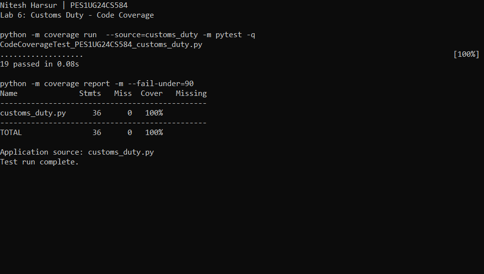
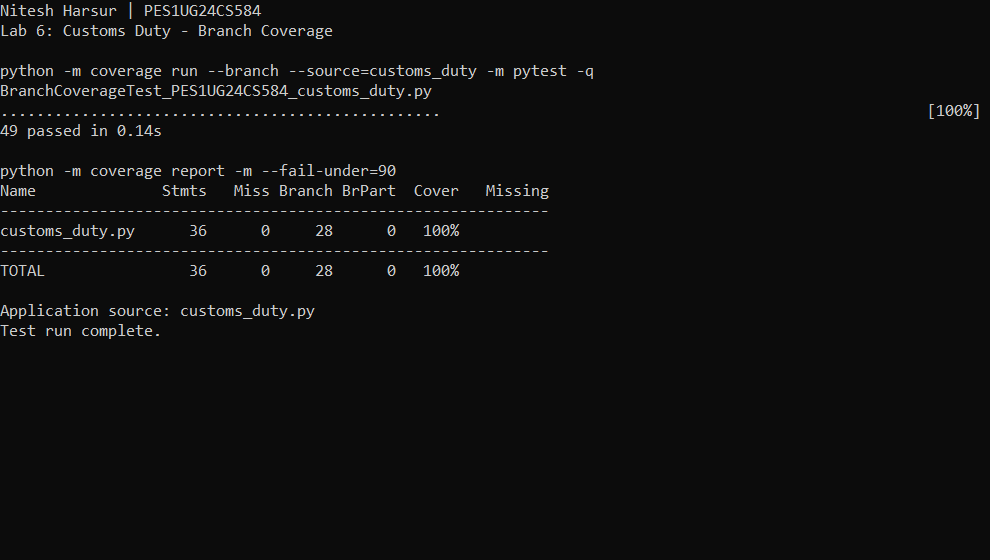

# Lab 6: Code and Branch Coverage Analysis

**Name:** Nitesh Harsur  
**SRN:** PES1UG24CS584  
**Assigned application:** Customs Duty Calculator  
**Repository:** https://github.com/SETAPESU26/L6_L7_35_customs_duty

## Objective

Measure the starter tests, add tests for untested statements and decision outcomes, and achieve at least 90% line and branch coverage of `customs_duty.py`.

## Results

| Run | Passing tests | Statements covered | Branch outcomes covered | Coverage report |
| --- | ---: | ---: | ---: | ---: |
| Starter, line measurement | 2 | 13/36 | Not measured | 36% |
| Starter, branch measurement | 2 | 13/36 | 7/28 | 31% combined |
| Final line suite | 19 | 36/36 | Not measured | 100% |
| Final branch suite | 49 | 36/36 | 28/28 | 100% |

Coverage.py's branch-mode `Cover` column combines statement and branch outcomes. It is not a standalone branch percentage. For the starter suite, the branch percentage is 7/28 = 25%, while the combined result is (13+7)/(36+28) = 31.25%. For the final branch suite, line coverage, branch coverage, and combined coverage are all 100%. There are no missing statements, missing branch outcomes, or partially covered branches.

Only the application module is included in coverage measurement using `--source=customs_duty`. The original application and starter tests are preserved.

## Initial gaps

The starter tests check the books rate and the low-value personal import exemption. They do not execute most duty rates, either error path, gift calculations, minimum duty adjustment, or any clearance decision. The initial measurements are retained in `evidence/baseline.txt`. Baseline screenshots are omitted as requested in the handout.

## Line coverage tests

`CodeCoverageTest_PES1UG24CS584_customs_duty.py` contains 19 test cases. These exercise all rate return values, prohibited goods and negative-value exceptions, gift and personal exemptions, allowance subtraction, positive duty calculations, the minimum duty adjustment, and all clearance return values.



## Branch coverage tests

`BranchCoverageTest_PES1UG24CS584_customs_duty.py` contains 49 test cases, including:

| Decision or boundary | Representative inputs | Expected behavior |
| --- | --- | --- |
| Prohibited category | weapons, narcotics | Rate calculation raises ValueError; clearance refuses |
| Origin-dependent rates | electronics/clothing with FTA and US | 10%/20% and 5%/12% respectively |
| Other rates | books and toys | 0% and 15% |
| Negative import value | -1 with gift true and false | ValueError before exemptions |
| Personal exemption | 999, 1000, 1001 | Zero, zero, then normal duty |
| Gift allowance | 4999, 5000, 5001 | Zero, zero, then duty on excess over 5000 |
| Minimum duty | electronics gift values 5249, 5250, 5251 | 50, 50, 50.2 |
| Zero duty above allowance | books at 5001 as gift | Zero, without minimum duty adjustment |
| Document check | 20000 and 20001, documents present/absent | Inspect only above 20000 when documents absent |
| High-value clearance | 99999, 100000, 100001 | Above 100000 always inspect |
| Prohibited priority | prohibited category at 100001 | Refuse takes priority over inspection |

Expected monetary values use `pytest.approx` for floating-point comparisons. Exception tests verify the error messages. The clearance cases also exercise short-circuit alternatives in `value > 20000 and not has_documents`.



The tests verify the supplied behavior. In the supplied application, exempt imports return before `duty_rate` is called, so `total_duty` alone does not validate prohibited categories for exempt values. `clearance_channel` separately refuses prohibited categories. The source was not changed to impose an unstated requirement.

## Reproduce the measurements

Open a terminal in this `lab6` directory and install the dependencies:

```powershell
python -m pip install -r requirements.txt
```

Run line coverage:

```powershell
python -m coverage erase
python -m coverage run --source=customs_duty -m pytest -q CodeCoverageTest_PES1UG24CS584_customs_duty.py
python -m coverage report -m --fail-under=90
```

Run branch coverage:

```powershell
python -m coverage erase
python -m coverage run --branch --source=customs_duty -m pytest -q BranchCoverageTest_PES1UG24CS584_customs_duty.py
python -m coverage report -m --fail-under=90
python -m coverage html -d evidence/html_branch
```

The filenames follow the handout's naming convention and must be passed explicitly to pytest because they do not match its default `test_*.py` discovery pattern. The interactive HTML report is available at `evidence/html_branch/index.html`. Machine-readable results are retained in the two coverage JSON files.

## Interpretation

Line coverage measures executed statements. Branch coverage measures control-flow alternatives. Executing every statement does not generally guarantee both outcomes of every decision. Path coverage measures complete execution paths, and function coverage measures which functions were invoked. This lab measured line and branch coverage; it does not claim complete path coverage.

The final line suite executes every application statement. The final branch suite exercises all 28 measured branch outcomes and adds boundary checks around the exemption, minimum-duty, and inspection thresholds. High coverage shows that the measured code paths ran; the assertions check the expected results for the selected inputs. Coverage alone cannot prove that a specification is complete or that all possible inputs behave correctly.

## Submission contents

Both required test files, the two final terminal screenshots, text and JSON evidence, this analysis, and the HTML branch report are included. The submission repository contains separate commits for the line and branch coverage stages. Submission repository: https://github.com/niteshharsur/SE-labs-PES1UG24CS584/tree/main/Lab_6
